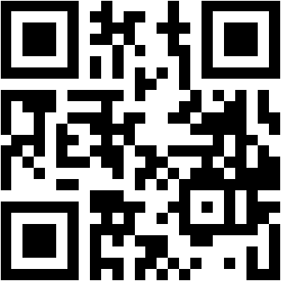

# Foodie App 🍲

A complete, modern React Native / Expo Recipe Application created for the Coursera Peer-Graded Assignment. Fully compatible with **Expo Go (SDK 54)** and **Snack Expo**.

---

## 📲 Quick Scan for Expo Go (SDK 54)

Scan this QR code with your camera or the **Expo Go** app on your phone:

  
  
<b>Expo Go URL:</b> <code>exp://192.168.0.185:8081</code>

*(Make sure your phone and laptop are connected to the same Wi-Fi network. You can also paste <code>exp://192.168.0.185:8081</code> manually in Expo Go under "Enter URL manually".)*

---

## 🚀 How to Run in Snack Expo

1. Open [Snack Expo](https://snack.expo.dev/).
2. Click **Import Git Repository** in the menu/settings.
3. Paste this GitHub repository URL: `<YOUR_PUBLIC_GITHUB_REPO_LINK>`
4. Snack Expo will immediately load the application, and you can view it directly in the web preview, iOS simulator, Android simulator, or on your device via **Expo Go**.

---

